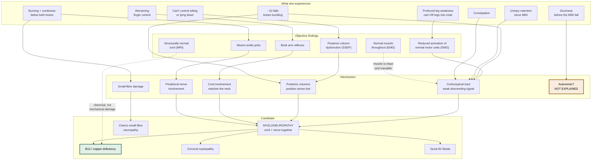

# Causal graph — Patient A

## Reading it

**Convergence.** Every path arrives at one node — cord *and* peripheral nerve
affected together. Individually, the leg weakness pointed at the cord and the
burning feet pointed at the nerves, and they were being managed as separate
problems by separate specialists. As one node they have a name and a much shorter
differential than either symptom alone.

**The orphan.** `Dizziness before the M60 fall` (amber) has nothing pointing at it —
the only symptom in the file with no finding behind it. It generated a specific,
free, five-minute request: a lying-and-standing blood pressure.

**The load-bearing dotted line.** `Normal muscle throughout` explains no symptom, so
a symptom-by-symptom reading drops it. It is the most hopeful fact in the file: the
muscle is intact and under-driven, not wasted, so strength is recoverable if the
signal is restored.

## The same thing as an analogy

| Part | What it is | State |
|---|---|---|
| Control room | The brain | **Working** — cognition, speech, swallowing, eye movements all normal |
| Main cable | The spinal cord | **Damaged** — the main problem |
| Floor wiring | Nerves in the feet | **Also affected** — new at M63 |
| Motors | The muscles | **Healthy** — and trainable |
