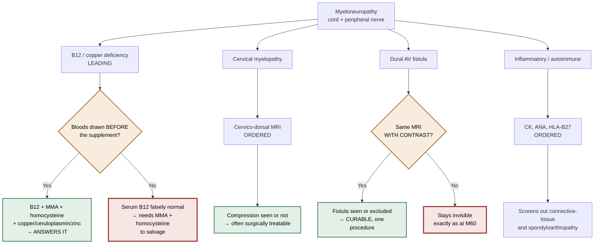

# Differential tree — Patient A

Built **backwards from the tests**, which is what makes the decision points visible.

## What the backwards view revealed

Two of the four branches hang on **diamonds, not on new tests**. The tests were
already ordered. What was undecided was a condition attached to each:

| Decision | Action | Cost | If missed |
|---|---|---|---|
| Bloods before the supplement | Draw blood first | Free — a sequencing decision | The most treatable candidate is crossed off for the wrong reason, and it looks like a normal result |
| Contrast on the MRI | One phone call | Free | The only *curable* candidate stays invisible |

**Drawn forwards**, the situation reads: *we have ordered the right tests and are
waiting for results.*

**Drawn backwards**, it reads: *two free actions this week decide whether these
results mean anything.*

That difference is the entire argument for drawing the tree.

## Prune order

If you can only chase one thing:

1. **Bloods before supplement** — cheapest, most reversible if positive, and the one
   actively being lost right now.
2. **Contrast on the scan** — one call, and the only curable candidate.
3. Everything on [`../analysis/gaps.md`](../analysis/gaps.md).
