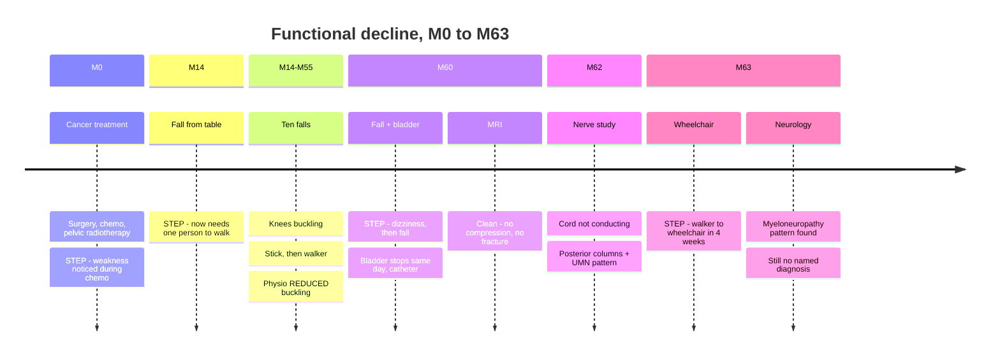
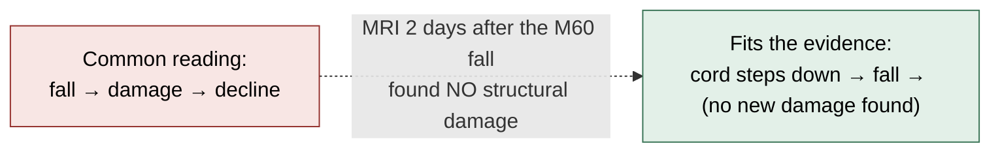

# Timeline as steps — Patient A

## The reversal

Four steps. Three followed a fall. The imaging two days after the most significant
one found nothing damaged — so the causal arrow most likely points the other way.

**Why it matters:** step-wise decline is a considerably shorter differential than
gradual decline, and the shorter list contains treatable entries. This observation
changed which specialty the case belonged to.
