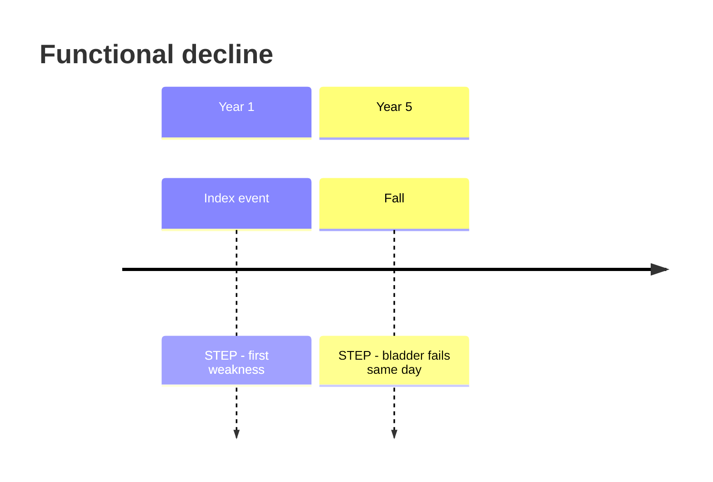

# 2 — Timeline with steps

**Is the decline a slope or a staircase? The answer narrows everything.**

## What it is

A single chronology of the whole illness, with one specific thing marked: the
moments where function dropped **suddenly** rather than gradually.

## When it pays

Any condition that has been going on long enough that nobody remembers the
beginning — which is most undiagnosed cases, and all of the slow ones.

Clinicians get the history in a ten-minute retelling, usually from the patient,
usually under time pressure, and usually reconstructed. You have the actual
sequence. Writing it down is the cheapest high-value thing in this method.

## How to run it

1. **One row per event**, with a date, what happened, and where it left the
   patient functionally. "Needed one person's support to walk" is a better entry
   than "deteriorated".
2. **Mark the steps.** A step is a drop that happened over hours or days, where
   the level before and after are clearly different. Mark them visually — **▼** in
   a table, a distinct colour in a diagram.
3. **Note what responded to treatment.** "Physiotherapy reduced the buckling
   episodes" is a documented response and is diagnostically useful. It is also the
   kind of thing that falls out of a retelling.
4. **Include the negative events** — the scan that found nothing, the test that
   came back normal. A clean scan at a known date is evidence, and its date is
   what makes it evidence.
5. **Then look at the steps alone.** Ask: what came immediately before each one?
   Is the apparent cause actually the cause?

## The move that makes this technique earn its place

Steps usually have an obvious precipitant, and the obvious reading is usually
"the precipitant caused the drop".

**Check whether the precipitant was itself caused by the drop.**

This sounds like wordplay and is not. The two readings imply completely different
differentials, different investigations, and sometimes a different specialty.

## What it caught in the worked example

Four steps across five years. Three followed a fall. The natural reading — and the
one carried through several years of referrals — was *she fell, and the fall
damaged something*.

But the imaging done **two days after** the most significant fall found no
structural damage of any kind: no fracture, no displaced disc, no bleed, no
compression.

So the other reading fits better: **the spinal cord took a sudden step down, and
that step caused the fall.** Which reverses the question from "what did the fall
break?" to "what makes a spinal cord drop suddenly, repeatedly, over years?" —
a far shorter list, and one containing several treatable entries.

That reframing came from a table with four rows marked **▼**.

## Rendering it

A markdown table is enough. If you want a diagram, Mermaid renders natively on
GitHub:

~~~

~~~
