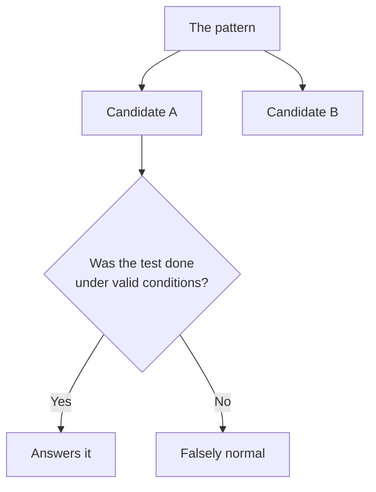

# 4 — Differential tree

**For each candidate: what supports it, what argues against it, and which single
test prunes it.**

## What it is

The live list of explanations, structured so that each one names **the one test
that would settle it**. Lives in `analysis/hypotheses.md` and is the file you
update most often.

## When it pays

As soon as you have more than one candidate — so, immediately. Its real value
arrives later, when results start coming back and you need to know what a result
*buys* you without re-reading everything.

## How to run it

One entry per candidate, four parts:

**Supporting** — every finding that fits, as a numbered list. Individually weak
items are fine and should be included; the argument is cumulative. Ten weak
findings pointing one way is a real signal, and it is invisible unless written
down together.

**Against** — be honest and specific. The entry for your favourite candidate
should contain the strongest argument against it that you can find. If it doesn't,
you are building a case, not a differential.

**What settles it** — the single investigation that moves this from `OPEN` to
`EXCLUDED` or `CONFIRMED`. If you cannot name one, say so; that is itself the
finding, and it belongs in [gap analysis](05-gap-analysis.md).

**Status** — `LEADING` · `OPEN` · `AWAITING TEST` · `WEAKENED` · `EXCLUDED`.

Then a separate **Excluded** table: what is off the table and the specific evidence
that took it off. This is as valuable as the live list — it stops a candidate being
re-raised at every appointment, and it shows a new clinician what ground has been
covered.

## The rules that keep it useful

**A result updates a status line. It does not trigger a rewrite.** The supporting
and against lists are a record of reasoning, and reasoning you overwrite is
reasoning you cannot audit.

**Never delete an excluded candidate.** Record why it was excluded. If the
exclusion later turns out to rest on a flawed test, you need to find it again.

**Keep the caveat attached to the leading candidate.** A hypothesis that fits ten
findings is still a hypothesis, and the leading entry is the one most likely to
harden into a belief. Write the honest limitation into the entry itself — including
what treatment would and would not be expected to recover.

## Drawing it as a tree

Build it **backwards from the tests**, not forwards from the candidates. It looks
like this:

~~~

~~~

The diamonds are the decision points, and they are the output. They tell you what
to actually *do* this week.

## What it caught in the worked example

Three live candidates, and the tree showed that **two of them hung on conditions
attached to tests that had already been ordered** — not on new tests at all:

- one candidate was settled by a blood panel, *but only if drawn before a
  supplement that had been prescribed the same day*
- another was settled by a scan that had been ordered, *but only if contrast was
  used*, which the order did not specify

Both conditions were free to satisfy — a sequencing decision and a phone call.
Neither was visible from the candidate list; both appeared the moment the tree was
drawn backwards from the tests.

Drawn forwards, the conclusion is "we are waiting for results". Drawn backwards,
it is "two actions this week decide whether these results mean anything."
